# High-speed 2-D DCT processor based on a modified Loeffler architecture

[](https://github.com/VKHS/2D-DCT-modified-Loeffler-architecture/actions/workflows/ci.yml)
[](https://doi.org/10.1109/IranianCEE.2019.8786608)
[](LICENSE)

Python, MATLAB, Verilog RTL and Vitis HLS implementations, bit-exact with each other, of the
processor in

> **A. K. Sadaghiani and M. Ghanbari, "An Optimized Hardware Design for high speed 2D-DCT
> processor based on modified Loeffler architecture,"** *2019 27th Iranian Conference on
> Electrical Engineering (ICEE)*, Yazd, Iran, 2019, pp. 1476–1480.
> doi: [10.1109/IranianCEE.2019.8786608](https://doi.org/10.1109/IranianCEE.2019.8786608) ·
> [IEEE Xplore](https://ieeexplore.ieee.org/document/8786608) ·
> [full text](https://www.researchgate.net/publication/334991904_An_Optimized_Hardware_Design_for_high_speed_2D-DCT_processor_based_on_modified_Loeffler_architecture)

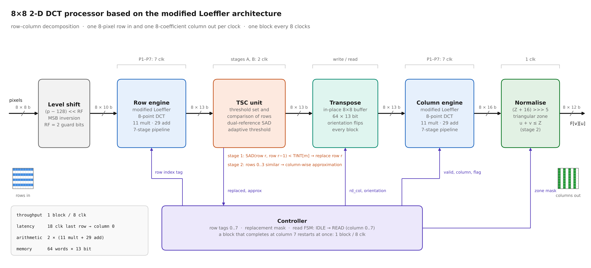

The paper presents a fast 2-D DCT architecture for hardware-efficient embedded systems and
power-limited applications such as the Internet of Things. It attacks the problem from two
sides: **structure**, with a modified, fully pipelined Loeffler DCT engine (11 multiplications,
29 additions per 8-point transform); and **operation reduction** in two stages:

1. **Threshold Set and Comparison (TSC)**: the DCT of two consecutive rows of an 8×8 block is
   compared against a threshold, and the second row is replaced by the first when they are
   similar enough. When the difference of consecutive rows is not below the threshold, the
   hardware raises the threshold in steps of 0.001 up to a maximum of 0.01.
2. **Column-wise approximation**: the second stage acts when the first four rows of a block
   are similar enough. It rests on the observation that the energy of an 8×8 DCT block is
   concentrated in a small triangle at its upper left, and approximates the DCT operations
   column-wise.

The paper's design was written in VHDL and implemented with Xilinx Vivado 2018.2 on an
Artix-7 FPGA at **207 MHz**.

---

## Contents

| folder | content |
|---|---|
| [`python/loeffler2d`](python/loeffler2d) | golden model: float and bit-accurate Loeffler engines, TSC unit, 2-D processor, operation counting, JPEG-style codec loop |
| [`python/tests`](python/tests) | 17 unit tests: algorithm, word lengths, TSC behaviour, vectors |
| [`python/scripts`](python/scripts) | vector generator, figure generator, evaluation table, RTL constant generator, VCD waveform plotter |
| [`matlab`](matlab) | MATLAB / Octave model, demo, smoke test |
| [`rtl`](rtl) | Verilog-2001 RTL: engine, TSC unit, in-place transpose, controller, top; self-checking test benches; Vivado synthesis script |
| [`hls`](hls) | Vitis HLS C++ (DATAFLOW, II = 1 loops), C-simulation test bench, `run_hls.tcl` |
| [`vectors`](vectors) | golden vectors shared by every test bench |
| [`docs`](docs) | [architecture reference](docs/architecture.md), [verification](docs/verification.md), figures |
| [`scripts`](scripts) | `smoke_test.sh`, Icarus and xsim regressions |

## Quick start

```bash
git clone https://github.com/VKHS/2D-DCT-modified-Loeffler-architecture.git
cd 2D-DCT-modified-Loeffler-architecture
python3 -m pip install -r python/requirements.txt
bash scripts/smoke_test.sh
```

The smoke test runs four stages against the same golden vectors and prints PASS, FAIL or
SKIPPED for each:

| stage | tool | checks |
|---|---|---|
| Python model | pytest | 17 tests: engines, word lengths, TSC behaviour, committed vectors |
| HLS C-simulation | g++ | `hls/` on both vector sets (63 blocks each) |
| Verilog RTL | Icarus Verilog | engine on 512 vectors; `dct2d_top` in two modes, back-to-back and with idle cycles |
| MATLAB model | Octave or MATLAB | `matlab/smoke_test_matlab.m` on both vector sets |

A stage whose tool is missing is skipped; the GitHub workflow installs Icarus Verilog and
Octave and runs all four stages on every push.

---

## 1. Background: the 2-D DCT by row–column decomposition

The orthonormal 8-point DCT-II of a row $x$ is

$$X[k] = \alpha_k \sum_{n=0}^{7} x[n]\cos\frac{(2n+1)k\pi}{16},\qquad \alpha_0=\sqrt{1/8},\ \ \alpha_{k>0}=\sqrt{2/8},$$

and the 2-D DCT of an 8×8 block $B$ is $F = C\,B\,C^{T}$: an 8-point DCT of every row followed
by an 8-point DCT of every column. As two 8×8 matrix products a block costs 1024
multiplications; with a fast 8-point algorithm the cost is 16 × (fast 1-D DCT):

| 8-point algorithm | multiplications | additions |
|---|---|---|
| direct matrix | 64 | 56 |
| Chen | 16 | 26 |
| Lee | 12 | 29 |
| **Loeffler** (theoretical minimum of multiplications) | **11** | **29** |

## 2. The modified Loeffler engine

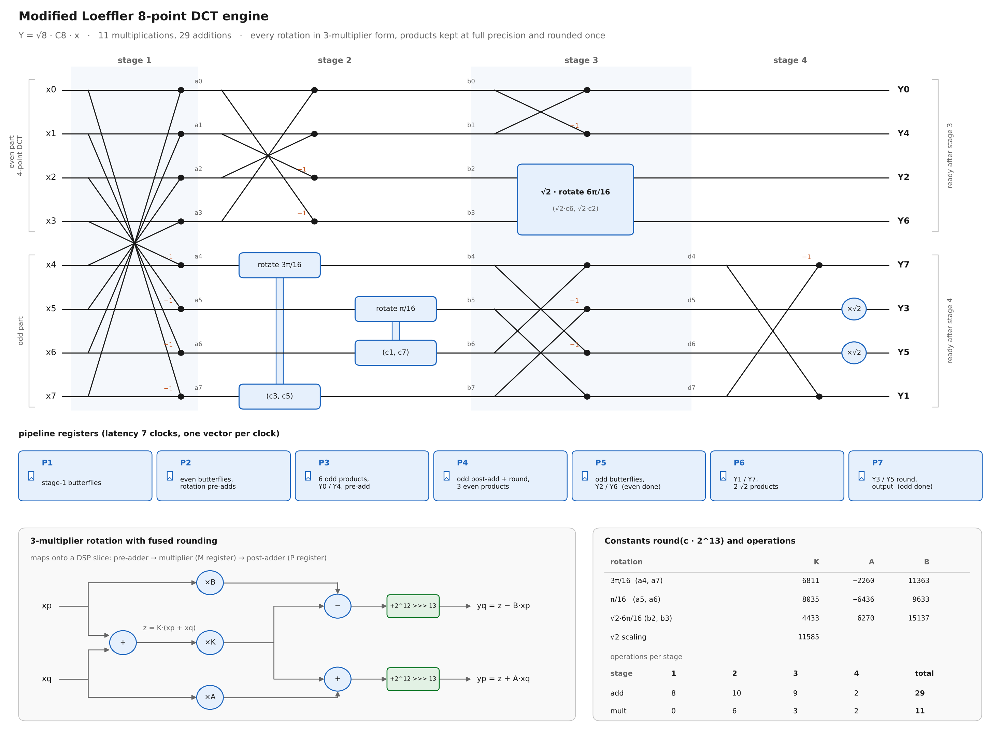

The engine computes $Y=\sqrt{8}\,C\,x$ in four stages. Stage 1 forms the sums and
differences $x_i \pm x_{7-i}$; the even half is a 4-point DCT and the odd half uses two plane
rotations (3π/16, π/16) and two √2 scalings. Every rotation uses three multipliers:

$$z = K\,(x_p + x_q),\qquad y_p = z + A\,x_q,\qquad y_q = z - B\,x_p .$$

In this implementation the three products are kept at full precision and each rotation
output is rounded once. The shared term $K(x_p+x_q)$ is a pre-addition followed by a
multiplication, and each output adds one more product: the pre-adder, multiplier and
post-adder of a DSP slice. The engine is pipelined with seven register stages, P1–P7; the
even outputs are complete after algorithmic stage 3 and the odd outputs after stage 4.

Because each pass scales by $\sqrt{8}$, the row and column passes together scale by exactly
8: the final normalisation is a rounding shift, $F=(Z+2^{RF+2})\gg(RF+3)$, with no
multiplier. The constants, the pipeline table and the worst-case word lengths are in
[docs/architecture.md](docs/architecture.md#2-loeffler-engine-loeffler_dct8v).

## 3. Operation reduction

### 3.1 Stage 1: Threshold Set and Comparison

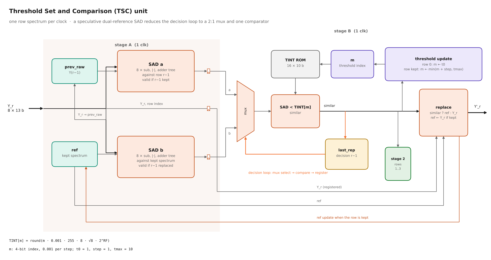

For row $r$ of a block, the unit compares the row spectrum $Y_r$ with the spectrum kept for
row $r-1$:

$$\mathrm{SAD}_r=\sum_{k=0}^{7}\bigl|Y_r[k]-Y_{\mathrm{ref}}[k]\bigr| \;<\; \mathrm{TINT}[m],\qquad \mathrm{TINT}[m]=\operatorname{round}\!\left(m\cdot 0.001\cdot 255\cdot 8\sqrt{8}\cdot 2^{RF}\right).$$

The test equals $\tfrac18\sum_k|X_r[k]-X_{\mathrm{ref}}[k]|/255 < 0.001\,m$ on the orthonormal row
spectrum of 8-bit pixels. A similar row is replaced by its predecessor; a dissimilar row
becomes the new reference and raises the threshold index $m$ by one step (0.001), up to
$t_{\max}$ = 0.010. The threshold restarts at $t_0$ in every block.

To process one row per clock, the RTL evaluates two SADs in parallel, against the previous
input row and against the kept spectrum, and the decision of row $r-1$ selects the valid one.
The feedback loop shrinks to a 2:1 multiplexer and one comparator.

### 3.2 Stage 2: column-wise approximation

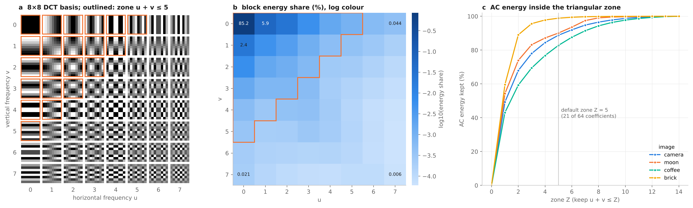

In natural images the energy of an 8×8 DCT block is concentrated in a small triangle at the
upper left (b). In this implementation the zone is $u+v\le Z$; the default $Z = 5$ keeps 21 of
the 64 coefficients and between 83 % and 99 % of the AC energy of the four images in (c).
A block is marked for stage 2 when at least `min_sim` (default 3) of the row pairs (1,0),
(2,1), (3,2) are similar; the column pass then delivers only the zone and the other
coefficients are zero.

## 4. Processor architecture

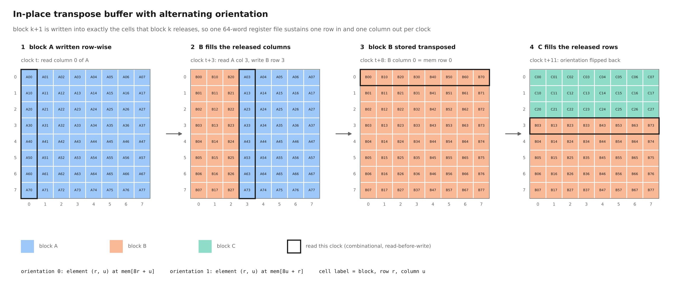

**In-place transpose.** The row spectra go into a single 64-word register file. A block
written row-wise is read column-wise while the next block is written column-wise into exactly
the cells being released; the orientation flips with every block, so one buffer sustains one
row in and one column out per clock.

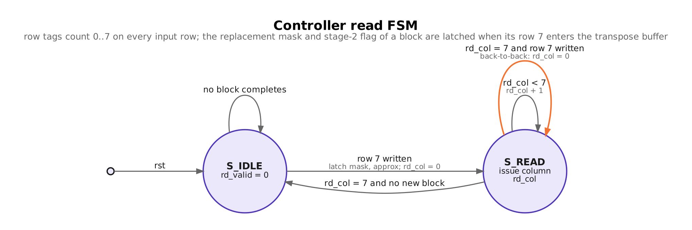

**Controller.** Rows are tagged 0..7 on entry. When row 7 of a block is written, the
replacement mask and the stage-2 flag of the block are latched, and the read FSM issues the
eight columns on the next eight clocks. A block that completes in the clock that issues
column 7 starts at once, so the processor accepts a new block every 8 clocks.

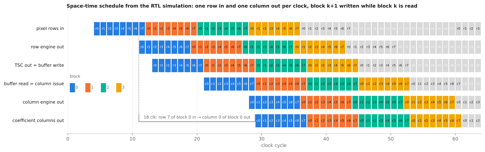

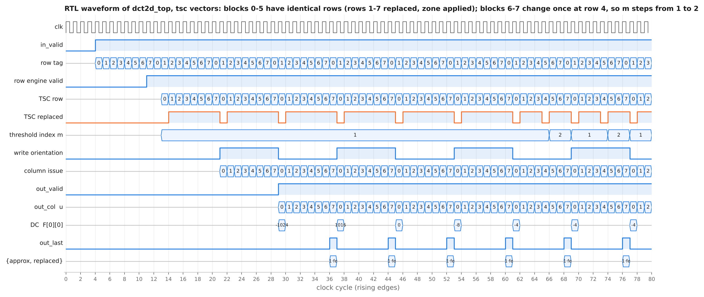

The schedule and the waveform are drawn from a VCD of `rtl/tb/tb_dct2d_top.v` with the
`tsc` vectors. Row 7 of block 0 enters at clock 11 and column 0 of block 0 leaves at clock 29:
18 clocks of latency, then one column per clock.

| `dct2d_top` | |
|---|---|
| input | one row of eight 8-bit pixels per clock (`in_valid`, `in_row[63:0]`) |
| output | one column of eight 12-bit coefficients per clock (`out_valid`, `out_col`, `out_coef[95:0]`), plus per-block `out_replaced[7:0]`, `out_approx` |
| configuration | `cfg_tsc_en`, `cfg_t0`, `cfg_step`, `cfg_tmax`, `cfg_min_sim`, `cfg_approx_mode`, `cfg_zone` |
| throughput / latency | 1 block per 8 clocks / 18 clocks from last row to first column |
| arithmetic | 2 engines × (11 multipliers + 29 adders) |
| storage | 64 × 13-bit transpose register file |

The port list and the timing of every block are in
[docs/architecture.md](docs/architecture.md#6-interface-of-dct2d_top).

## 5. Fixed-point design

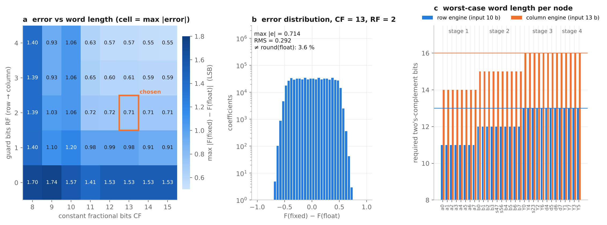

| parameter | value | role |
|---|---|---|
| CF | 13 | fractional bits of the rotation constants (15-bit signed) |
| RF | 2 | guard bits carried from the row to the column pass |
| row engine | 10-bit input, 13-bit data | set by the worst-case range of every node (c) |
| column engine | 13-bit input, 16-bit data | idem |
| output | 12-bit two's complement | orthonormal 2-D DCT; 8-bit pixels give −1024 … 1020 |

Panel a sweeps both parameters over 6000 random blocks and the 4096 blocks of *camera*. With
two guard bits the largest error falls to 0.72 LSB at CF = 11 and to 0.71 LSB at CF = 13, where
longer constants stop changing it. Without guard bits it stays above 1.4 LSB; with one it
stays between 0.91 and 1.2 LSB. Each further guard bit lowers it (0.61 LSB at RF = 3, 0.57 LSB
at RF = 4) and widens the column engine and the transpose buffer by one bit. At the chosen
point the RMS error is 0.292 LSB, close to the 0.289 LSB of rounding alone, and 3.6 % of the
coefficients differ from the rounded floating-point DCT (b). On the eight images of
section 6.2 the largest error is 0.69–0.76 LSB.

## 6. Results

### 6.1 Reported in the paper

| | value |
|---|---|
| DCT engine | modified Loeffler, fully pipelined |
| multiplications / additions per 8-point DCT engine | 11 / 29 |
| LUT | 1190 |
| FF | 1304 |
| power | 474 mW |
| clock frequency | **207 MHz** |
| platform | Artix-7 FPGA, Xilinx Vivado 2018.2, VHDL |

### 6.2 Measured with this repository

Image quality and arithmetic of the bit-exact model with the default TSC setting
(t0 = 0.001, step = 0.001, tmax = 0.010, min_sim = 3, Z = 5), from
`python3 python/scripts/evaluate.py`:

| image | size | max \|F − F<sub>float</sub>\| exact (LSB) | rows replaced | blocks approx. | PSNR exact / TSC (dB) | JPEG q50 exact / TSC (dB) | JPEG q75 exact / TSC (dB) | column mult / add per block |
|---|---|---|---|---|---|---|---|---|
| camera | 512×512 | 0.71 | 22.2 % | 0.0 % | 58.78 / 54.17 | 32.59 / 32.59 | 35.07 / 35.06 | 84.6 / 213.6 |
| moon | 512×512 | 0.76 | 59.8 % | 1.9 % | 61.31 / 57.62 | 41.09 / 41.07 | 43.25 / 43.22 | 86.3 / 132.7 |
| coffee | 600×400 | 0.69 | 9.8 % | 0.0 % | 58.74 / 54.77 | 32.39 / 32.38 | 34.93 / 34.92 | 87.1 / 227.6 |
| chelsea | 448×296 | 0.69 | 10.7 % | 0.0 % | 61.09 / 54.32 | 35.25 / 35.23 | 37.59 / 37.55 | 86.9 / 226.0 |
| brick | 512×512 | 0.69 | 30.0 % | 0.0 % | 58.78 / 53.20 | 38.98 / 38.95 | 41.45 / 41.39 | 84.1 / 210.7 |
| gravel | 512×512 | 0.69 | 0.1 % | 0.0 % | 58.72 / 58.64 | 30.57 / 30.57 | 33.05 / 33.05 | 88.0 / 232.0 |
| clock | 400×296 | 0.69 | 33.8 % | 0.0 % | 58.72 / 51.08 | 45.70 / 45.62 | 47.22 / 47.05 | 85.1 / 219.0 |
| rocket | 640×424 | 0.75 | 44.7 % | 3.1 % | 61.74 / 54.17 | 35.20 / 35.19 | 38.59 / 38.55 | 77.7 / 172.7 |

"PSNR" is the reconstruction from unquantised coefficients; "JPEG q50/q75" quantises with the
standard luminance table first. Averaged over the eight images, 26.4 % of the rows are
replaced, 0.6 % of the blocks are approximated, the column pass needs 85.0 multiplications and
204.3 additions per block instead of 88 and 232, and the JPEG-q75 PSNR drops by 0.05 dB. With
t0 = 0.003 (`evaluate.py --t0 3`) the same figures are 37.1 %, 9.8 %, 77.6 / 177.4 and 0.13 dB.

The operation counts come from the Loeffler flow graph in
[`opcount.py`](python/loeffler2d/opcount.py). An operation is counted when its result is not
already known: operations with a zero operand, a pass-through, x + x (a shift) or a result
that repeats an earlier value are free, and an approximated block computes only the
coefficients of its zone. Replaced rows make column inputs equal, which removes mostly
additions; multiplications vanish mainly when a multiplier input becomes zero. The counts are
the arithmetic a data-aware engine with operand isolation would execute; the pipelined RTL
runs both engines on every clock and produces the same coefficients either way.

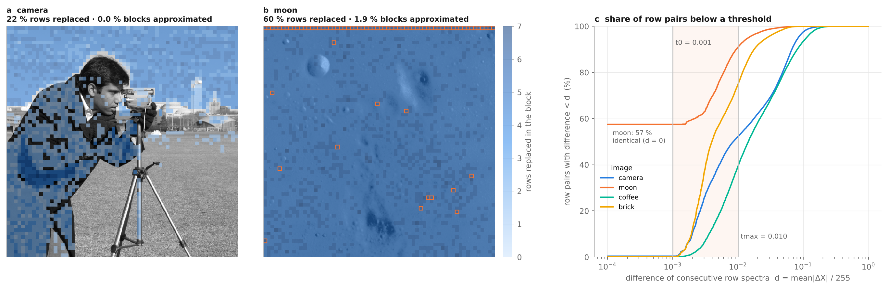

Smooth regions lose most of their rows to replacement, on average 4.2 of 7 in the sky of
*camera*, while its grass keeps nearly all of them (a, b). The cumulative distribution (c) shows the
share of consecutive row pairs under each threshold: below tmax = 0.010 fall 91 % of the pairs
of *moon* and 75 % of *brick*, but only 52 % of *camera* and 39 % of *coffee*; 57 % of the
row pairs of *moon* are identical.

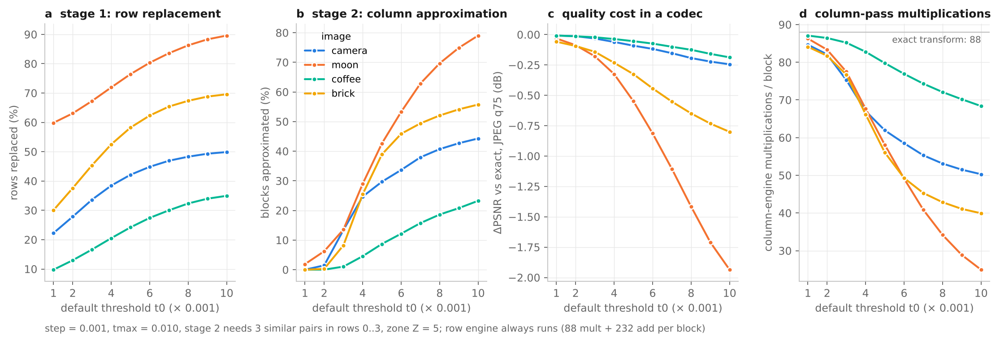

Raising the default threshold t0 increases both reduction stages and lowers the column-pass
arithmetic. Inside a JPEG-style codec at quality 75 the cost stays within 0.2 dB for
t0 ≤ 0.003 on these four images and grows fastest for the smooth *moon*.

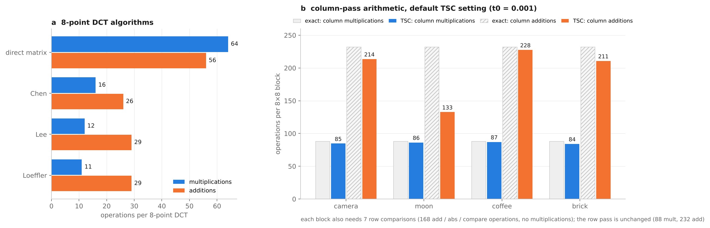

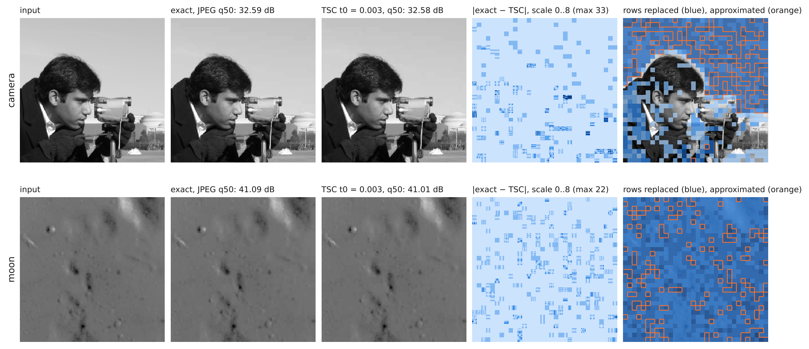

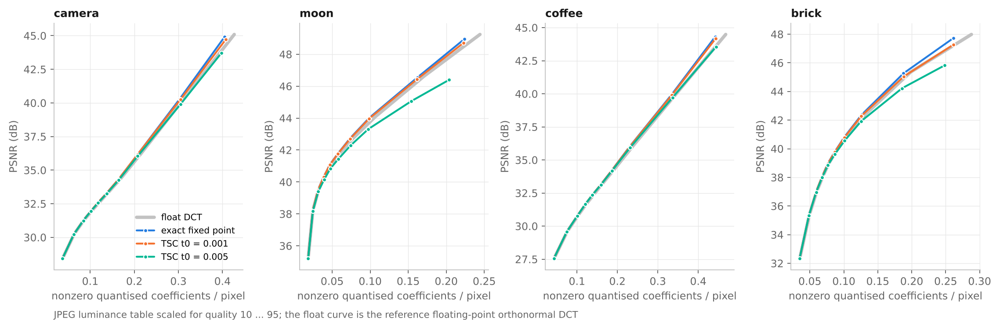

---

## 7. Implementations

### Python

```python
import numpy as np
from loeffler2d import ModifiedLoeffler2D, FixedPointConfig, TSCConfig, EXACT

proc = ModifiedLoeffler2D(FixedPointConfig(coef_frac=13, row_frac=2),
                          TSCConfig(t0=1, step=1, tmax=10, min_similar=3, zone=5))
coef_img, info = proc.forward(image_u8)            # blockwise 2-D DCT, 12-bit integers
rec = proc.inverse(coef_img, image_u8.shape)        # floating-point inverse
print(info.replaced.mean(), info.approx.mean())     # TSC decisions per block

exact = ModifiedLoeffler2D(FixedPointConfig(), EXACT)   # both reduction stages off
```

Run `PYTHONPATH=python python3 -c "..."` from the repository root, or add `python/` to the path.

### MATLAB / Octave

```matlab
cd matlab
smoke_test_matlab                    % golden vectors
cfg = default_config();              % cfg.tsc_enable = false; cfg.approx_mode = 0 -> exact
[C, info] = dct2d_image(img, cfg);   % coefficient image + TSC maps
demo_modified_loeffler               % figures and PSNR report
```

### Verilog RTL

```bash
bash scripts/run_rtl_sim.sh                              # Icarus Verilog, 5 self-checking runs
bash scripts/run_xsim.sh                                 # Vivado simulator
vivado -mode batch -source rtl/synth/synth_artix7.tcl    # OOC synthesis + implementation, reports in build/vivado
```

`rtl/synth/dct2d_top.xdc` constrains the clock to 4.831 ns, the 207 MHz of the paper; the part
is set with `DCT_PART` (default `xc7a100tcsg324-1`).

### Vitis HLS

```bash
vitis_hls -f hls/run_hls.tcl              # csim on the golden vectors + csynth
DCT_COSIM=1 vitis_hls -f hls/run_hls.tcl  # + C/RTL co-simulation
make hls-csim                             # C simulation with g++ only
```

`dct2d_modified_loeffler()` processes one block: the row pass (row engine + TSC) and the
column pass (column engine + normalisation + zone) form a `DATAFLOW` region whose loops carry
`PIPELINE II=1`. Without the Xilinx headers the code uses standard integer types; no node
exceeds its declared width, so both builds produce the same integers. The part and the clock
come from `DCT_PART` and `DCT_CLK_NS` (default `xc7a100tcsg324-1`, 5 ns).

## 8. Verification

Every implementation is checked against the same golden vectors from the Python model
(63 blocks in two modes, plus 512 engine vectors): extreme sign patterns of every DCT basis
function, ramps, edges, checkerboards, flat and near-flat blocks, noise and natural-image
crops. The Verilog test bench checks every coefficient, the column order and the per-block TSC
status, with and without idle cycles between input rows. Details:
[docs/verification.md](docs/verification.md).

## 9. Reproducing the figures

```bash
make figures       # Icarus run with a VCD dump, then python/scripts/make_figures.py
```

`python3 python/scripts/make_figures.py` without `--vcd` redraws every figure except the
waveform and the schedule. The test images come from scikit-image (`camera`, `moon`,
`coffee`, `chelsea`, `brick`, `gravel`, `clock`, `rocket`).

## Citation

```bibtex
@inproceedings{Sadaghiani2019DCT,
  author    = {Khalili Sadaghiani, AbdolVahab and Ghanbari, Mohammad},
  title     = {An Optimized Hardware Design for high speed {2D-DCT} processor based on modified {Loeffler} architecture},
  booktitle = {2019 27th Iranian Conference on Electrical Engineering (ICEE)},
  address   = {Yazd, Iran},
  pages     = {1476--1480},
  year      = {2019},
  doi       = {10.1109/IranianCEE.2019.8786608}
}
```

## License

[MIT](LICENSE)
